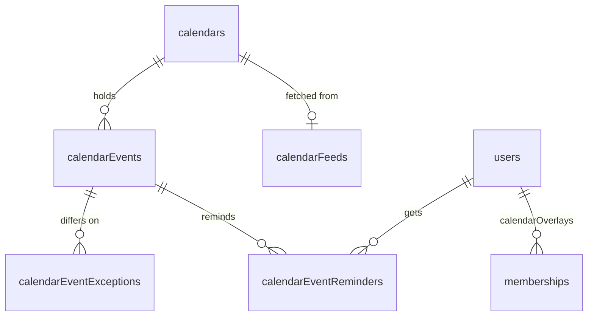

# Calendar data model: APP-330, 331, 332, 333, 343

Round 1, 27 Nov 2026. Canvas: https://claude.ai/artifact/DzD5jRyszXzUKo2bFNmCXN (page "Agenda · overzicht en datamodel").
One schema change covers repeating (330) and multi-day (331); 332, 333 and 343 add to it.

## calendarEvents (changed)

| Field | Type | Required | Meaning |
| --- | --- | --- | --- |
| `date` | `v.string()` | yes | Start date, YYYY-MM-DD (unchanged) |
| `startMinutes`, `endMinutes` | `v.optional(v.number())` | no | Unchanged; `endMinutes` is now on `endDate` |
| `endDate` (new) | `v.optional(v.string())` | no | End date; absent = same day as `date`. Night shift: `date` Thu, `startMinutes` 1320, `endDate` Fri, `endMinutes` 360 |
| `repeat` (new) | `v.optional(eventRepeatValidator)` | no | `{ unit: day|week|month|year, every, weekdays?, monthRule?: {day: N} | {nth: 1..4 or -1, weekday} | {last: true}, ends: {never} | {until: date} | {count: N} }`, shaped like `taskRepeat` where it can be |
| `externalUid` (new) | `v.optional(v.string())` | no | ICS `UID`, only on imported events |
| `sourceTimeZone` (new) | `v.optional(v.string())` | no | ICS `TZID`; imported events keep the source zone (redesign record) |

New index `by_calendar_uid` (`calendarId`, `externalUid`): a refresh updates instead of duplicating.
Occurrences are expanded server-side for the requested window; only exceptions are stored.

## calendarEventExceptions (new)

| Field | Type | Required | Meaning |
| --- | --- | --- | --- |
| `eventId` | `v.id('calendarEvents')` | yes | The series |
| `occurrenceDate` | `v.string()` | yes | The original date of that occurrence |
| `cancelled` | `v.optional(v.boolean())` | no | "Delete this event only" |
| `override` | `v.optional(v.object({ title?, date?, endDate?, startMinutes?, endMinutes?, location?, notes?, assigneeIds? }))` | no | "This event only" edits |

Index `by_event_date` (`eventId`, `occurrenceDate`). "This and following" splits: the old series gets `ends.until` = the day before, and a new `calendarEvents` row starts on that day.

## calendars (changed)

| Field | Type | Required | Meaning |
| --- | --- | --- | --- |
| `source` (changed) | `v.union(v.literal('local'), v.literal('subscription'))` | yes | Was only `'local'` |
| `subscription` (new) | `v.optional(v.object({ lastSyncedAt?, lastError?, eventCount }))` | no | Status shown as "Updated 14:02" or "Couldn't update · last 09:00" |

## calendarFeeds (new, server-only)

| Field | Type | Required | Meaning |
| --- | --- | --- | --- |
| `calendarId` | `v.id('calendars')` | yes | The subscription calendar |
| `url` | `v.string()` | yes | Feed URL; never returned to a client in full (can be a secret address) |
| `etag`, `lastModified` | `v.optional(v.string())` | no | Conditional fetches |

Index `by_calendar`.

## calendarEventReminders (new, personal)

| Field | Type | Required | Meaning |
| --- | --- | --- | --- |
| `eventId` | `v.id('calendarEvents')` | yes | The event (series for repeating events) |
| `userId` | `v.id('users')` | yes | Whose reminder |
| `minutes` | `v.union(v.number(), v.literal('off'))` | yes | Minutes before; `off` = none for this person |

Indexes `by_event_user`, `by_user`. Sending uses the existing `scheduledNotifications` (kinds `eventReminder` and `eventAssignment` already exist); repeating events schedule only the next occurrence.

## users and memberships (changed)

- `users.eventReminderDefault` (new): `v.optional(v.union(v.number(), v.literal('off')))`; absent = 15 minutes.
- `memberships.calendarOverlays` (new): `v.optional(v.object({ meals: v.boolean(), tasks: v.boolean() }))`; absent = both off.

## Existing data

Nothing is rewritten. Every new field is optional: an event without `endDate` is one day, without `repeat` it does not repeat. No backfill. This differs from APP-331's "migrate with end date = start date": not needed, and installed phones keep reading `date`, `startMinutes` and `endMinutes` as today (they see only the first day of a multi-day event until their OTA).

- Removing a subscription deletes its imported events, its exceptions and its `calendarFeeds` row.
- Account deletion deletes the person's `calendarEventReminders`; Group deletion deletes everything above through the existing cascade.
- Export: the person's own reminders and the Group's exceptions are included; the feed URL is not.
