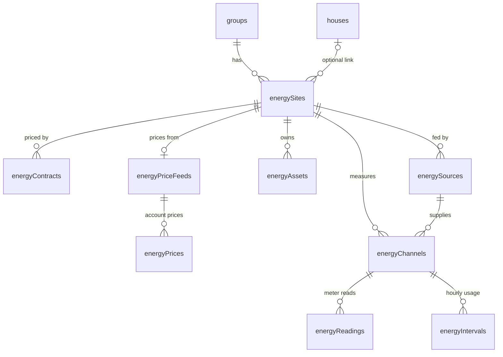

# Energy — data model (APP-491)

Approved by Eric on 20 November 2026, together with the Energy design
(direction A). The build follows this model; a schema that deviates from it
(another field, type, index or data treatment) goes back to Eric before merge.

Nine new tables. No existing table changes. Everything is Group-scoped except
market prices, which are the same for every Group. Money totals are cents like
the rest of Gather; prices per kWh or m³ are euros as a decimal number, because
cents are too coarse there.

## energySites

| Field | Type | Required | Meaning |
| --- | --- | --- | --- |
| `groupId` | `v.id('groups')` | yes | Owning Group |
| `name` | `v.string()` | yes | "Thuis", "Vakantiehuis" |
| `houseId` | `v.id('houses')` | no | Link to a Finances House |
| `createdByUserId` | `v.id('users')` | yes | Who added it |
| `order` | `v.number()` | yes | Sort order |

Index `by_group`.

## energyContracts

| Field | Type | Required | Meaning |
| --- | --- | --- | --- |
| `groupId`, `siteId` | ids | yes | Owner and site |
| `validFrom` | `v.string()` YYYY-MM-DD | yes | First day this contract applies |
| `kind` | `'dynamic' \| 'fixed'` | yes | Contract type |
| `supplierName` | `v.string()` | no | Display only |
| `importMarkupEurPerKwh` | `v.number()` | yes | Supplier markup on import, excl. VAT |
| `exportFeeEurPerKwh` | `v.number()` | yes | Export compensation (+) or export cost (−) |
| `energyTaxEurPerKwh` | `v.number()` | yes | Energy tax electricity, excl. VAT |
| `gasMarkupEurPerM3`, `gasTaxEurPerM3` | `v.number()` | no | Gas equivalents |
| `fixedTariffs` | `v.object({ t1, t2, export, gas })` | no | Only for `fixed` contracts |
| `vatPercent` | `v.number()` | yes | 21 today |
| `monthlyFixedCents` | `v.number()` | yes | Standing charges + network costs |
| `yearlyTaxCreditCents` | `v.number()` | no | Vermindering energiebelasting |
| `netMetering` | `v.boolean()` | yes | Salderen; treated as off from 2027-01-01 |

Index `by_site_validFrom`: the contract that applies on a day.

## energySources

| Field | Type | Required | Meaning |
| --- | --- | --- | --- |
| `groupId`, `siteId` | ids | yes | Owner and site |
| `kind` | `'manual' \| 'homeAssistant' \| 'enelogic' \| 'homeWizard'` | yes | Provider |
| `label` | `v.string()` | yes | "Home Assistant thuis" |
| `baseUrl` | `v.string()` | no | Home Assistant external URL |
| `secret` | `v.string()` | no | Token or OAuth refresh token; server-only, never returned |
| `status` | `'ok' \| 'syncing' \| 'error' \| 'needsReconnect'` | yes | Explicit state (ADR-0020) |
| `lastSyncedAt` | `v.number()` | no | Last successful sync |
| `lastError` | `v.string()` | no | Shown to members |
| `connectedByUserId` | `v.id('users')` | yes | Who connected it |

Indexes `by_site`, `by_kind_status` (the sync cron picks due sources).

## energyChannels

| Field | Type | Required | Meaning |
| --- | --- | --- | --- |
| `groupId`, `siteId`, `sourceId` | ids | yes | Owner, site, provider |
| `kind` | `'gridImport' \| 'gridExport' \| 'solar' \| 'batteryCharge' \| 'batteryDischarge' \| 'batterySoc' \| 'gas'` | yes | What it measures |
| `tariff` | `'t1' \| 't2'` | no | Split meters only |
| `unit` | `'kWh' \| 'm3' \| 'percent'` | yes | Unit |
| `externalRef` | `v.string()` | no | HA statistic id, Enelogic measuring point, HomeWizard serial |
| `assetId` | `v.id('energyAssets')` | no | Solar array or battery it belongs to |
| `retiredAt` | `v.number()` | no | Meter swap: the old channel stops, a new one starts |

Indexes `by_site`, `by_source`.

## energyAssets

| Field | Type | Required | Meaning |
| --- | --- | --- | --- |
| `groupId`, `siteId` | ids | yes | Owner and site |
| `kind` | `'solar' \| 'battery'` | yes | Type |
| `name` | `v.string()` | yes | "Dak zuid", "Thuisbatterij" |
| `peakWatt` | `v.number()` | no | Solar only |
| `capacityKwh` | `v.number()` | no | Battery only |
| `installedOn` | `v.string()` | no | YYYY-MM-DD |
| `purchaseCents` | `v.number()` | no | For payback |

Index `by_site`.

## energyReadings

| Field | Type | Required | Meaning |
| --- | --- | --- | --- |
| `groupId`, `channelId` | ids | yes | Owner and channel |
| `at` | `v.number()` | yes | Moment of the reading |
| `value` | `v.number()` | yes | Cumulative counter in the channel unit |
| `enteredByUserId` | `v.id('users')` | no | Set for manual readings |

Index `by_channel_at`: readings in order, previous-reading check.

## energyIntervals

| Field | Type | Required | Meaning |
| --- | --- | --- | --- |
| `groupId`, `channelId` | ids | yes | Owner and channel |
| `hourStart` | `v.number()` | yes | Start of the UTC hour |
| `amount` | `v.number()` | yes | kWh or m³ in that hour (state of charge: average %) |
| `estimated` | `v.boolean()` | yes | Spread from manual readings |

Index `by_channel_hour`: charts and sync upserts. About 8,800 rows per channel
per year; a typical site with 7 channels is about 60k rows a year. Day and month
totals are computed in queries first; a rollup table only if that is slow (a
deviation that goes back to Eric).

## energyPriceFeeds

One per site: where its prices come from. Bring your own key (Eric, 20 Nov 2026).

| Field | Type | Required | Meaning |
| --- | --- | --- | --- |
| `groupId`, `siteId` | ids | yes | Owner and site |
| `provider` | `'energyzero' \| 'entsoe' \| 'tibber'` | yes | Price source; a new provider is a new literal |
| `scope` | `'market' \| 'account'` | yes | Market price (shared) or the member's own supplier price |
| `secret` | `v.string()` | no | The member's API key or token; server-only, never returned |
| `includesTaxes` | `v.boolean()` | yes | All-in account prices skip the contract's markup and taxes |
| `status` | `'ok' \| 'error' \| 'needsKey'` | yes | Explicit state |
| `lastFetchedAt`, `lastError` | number, string | no | Shown to members |

Indexes `by_site`; `by_provider` (the price cron fetches each market provider
once, with any valid key).

## energyPrices

| Field | Type | Required | Meaning |
| --- | --- | --- | --- |
| `provider` | `v.string()` | yes | Feed provider: "energyzero", "entsoe", "tibber" |
| `feedId` | `v.id('energyPriceFeeds')` | no | Only for account prices; then Group-scoped |
| `carrier` | `'electricity' \| 'gas'` | yes | Commodity |
| `start` | `v.number()` | yes | Start of the slot (UTC) |
| `minutes` | `v.number()` | yes | 15 for electricity, 1440 for gas |
| `eurPerUnit` | `v.number()` | yes | Price; excl. tax for market feeds |

Indexes `by_provider_carrier_start` (market prices for a day, shared by all
Groups) and `by_feed_carrier_start` (account prices).

## Existing data

- No existing table or row changes; no migration or backfill.
- Group and account deletion (`convex/cascade.ts`) removes every Group-scoped
  energy table, including price feeds with their keys and account prices.
  Market prices (no `feedId`) stay.
- Data export includes sites, contracts, assets, channels, readings and hourly
  intervals; never `secret`.
- `houseId` is optional: deleting a House clears the link; the site stays.
- No ADR-0029 risk: no field that installed phones read changes.
