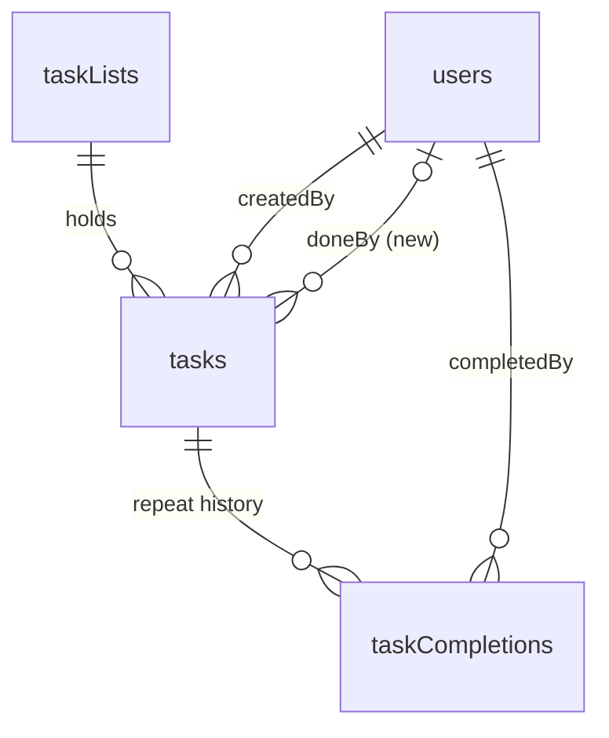

# APP-543 data model: who checked a task

Approved by Eric, 21 November 2026, with the design (README, "Who checked it").

## `tasks` (changed)

| Field | Type | Required | Meaning |
| --- | --- | --- | --- |
| `done` | `v.boolean()` | yes | Unchanged |
| `doneAt` | `v.optional(v.number())` | no | Unchanged: when last checked, cleared on uncheck |
| `doneBy` (new) | `v.optional(v.id('users'))` | no | Who last checked the task. Set by the server from the signed-in user wherever `doneFields` checks a task (`toggleDone`, `update`, `setDoneInList`); cleared on uncheck, exactly like `doneAt` |

No new index: shopping mode reads the list through `by_list`. Repeating tasks
are untouched: they never set `done`, and `taskCompletions.completedBy` already
records who completed an occurrence.

## Existing data

- Widened with an optional field. **No backfill**: who checked older items is
  unknown, and those rows show no line.
- Mutation arguments do not change, so installed apps of every version write
  `doneBy` on each check; older apps ignore the field (OTA-safe).
- Names are resolved on the phone from the Group's members, as for the
  assignee, so a Member who left or deleted their account shows no line.
- Data export rewrites `doneBy` to a name like every user id (`null` for a
  non-Member). Account and Group deletion: nothing new; the row goes with its
  list, and a dangling `doneBy` is treated like a dangling `createdBy`.
