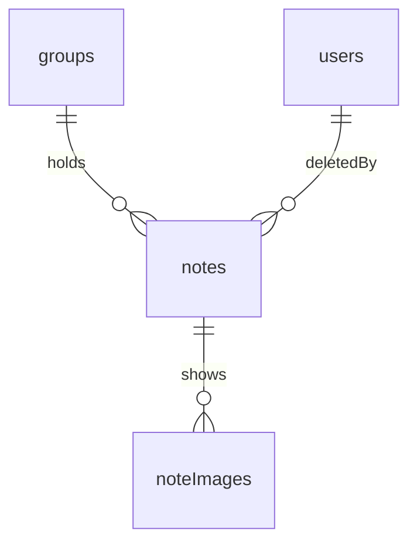

# Notes data model: APP-345, 346, 349

Approved 27 Nov 2026 with the design ([notes_final.md](notes_final.md)). APP-350 changes no schema.

## notes (changed)

| Field | Type | Required | Meaning |
| --- | --- | --- | --- |
| `body` | `v.string()` | yes | Type unchanged. Now Markdown (headings, bold, italic, links, lists, `- [ ]` checklist lines). Plain text is valid Markdown. |
| `deletedAt` (new, 346) | `v.optional(v.number())` | no | When it was deleted; absent = not deleted |
| `deletedBy` (new, 346) | `v.optional(v.id('users'))` | no | Who deleted it ("Verwijderd door Anne") |

New index `by_group_and_deletedAt` (`groupId`, `deletedAt`): the Recently deleted list and the daily purge.
Lists, search and MCP filter out rows with `deletedAt`. A daily cron deletes notes whose `deletedAt` is older than 30 days, with their photos.
`searchText` is built from the body with the Markdown stripped.

## noteImages (new, 349)

Photos in a note, under the [stored-files contract](../../docs/contracts/stored-files.md).

| Field | Type | Required | Meaning |
| --- | --- | --- | --- |
| `groupId` | `v.id('groups')` | yes | Cascade and access |
| `noteId` | `v.id('notes')` | yes | The note |
| `storageId` | `v.id('_storage')` | yes | The photo (preset `note`, max 2048 px) |
| `thumbStorageId` | `v.optional(v.id('_storage'))` | no | Small version for the list |
| `width`, `height` | `v.number()` | yes | So the note does not jump while loading |
| `createdBy` | `v.id('users')` | yes | Who added it |

Indexes `by_note`, `by_group`. The body references a photo as ``; a photo no longer referenced is removed on save.

## Existing data

Nothing is rewritten and there is no backfill. Every note stays visible (`deletedAt` absent) and its body stays valid. Installed phones keep showing the body as text until their OTA; formatting then shows as Markdown characters there, which is readable.

- Group or account deletion also deletes deleted notes and `noteImages` with their files (a new row in the cascade and in stored files).
- Export: notes including deleted ones (with `deletedAt`), and the photos as files.
