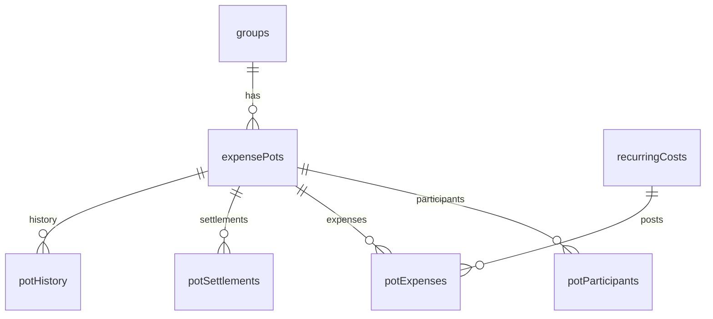

# Shared costs data model: APP-324, 325, 326, 327

Approved by Eric on 27 Nov 2026 with the design ([shared-costs_final.md](shared-costs_final.md)). Canvas: https://claude.ai/artifact/NPD3Zz5t2aVDXXrJQ9zivi (page "Geld · datamodel").
Money is in euro cents (ADR-0040). Balances and transfers are derived, never stored: they follow from expenses and settlements (pure functions in `packages/core/finance`, unit tested).

## expensePots (new, 324)

| Field | Type | Required | Meaning |
| --- | --- | --- | --- |
| `groupId` | `v.id('groups')` | yes | Owner Group |
| `name` | `v.string()` | yes | "Weekend Texel" |
| `status` | `v.union(v.literal('open'), v.literal('closed'))` | yes | Closing needs every balance at zero (325) |
| `closedAt` | `v.optional(v.number())` | no | When it was closed |
| `createdBy` | `v.id('users')` | yes | |
| `createdAt` | `v.number()` | yes | |

Index `by_group_status` (`groupId`, `status`).

## potParticipants (new, 324)

| Field | Type | Required | Meaning |
| --- | --- | --- | --- |
| `groupId`, `potId` | ids | yes | |
| `party` | `splitPartyValidator` | yes | `{ userId?, name }`: a Member (with `userId`) or a guest (name only). The name is a snapshot, so a Member who leaves still reads correctly. |
| `paymentLink` | `v.optional(v.string())` | no | https Tikkie or bank payment-request link for this pot (325) |
| `order` | `v.number()` | yes | |

Index `by_pot`.

## potExpenses (new, 324; 326 and 327 add fields)

| Field | Type | Required | Meaning |
| --- | --- | --- | --- |
| `groupId`, `potId` | ids | yes | |
| `description` | `v.string()` | yes | |
| `amountCents` | `v.number()` | yes | |
| `date` | `v.string()` | yes | YYYY-MM-DD |
| `paidBy` | `v.id('potParticipants')` | yes | |
| `category` | `potCategoryValidator` | yes | New closed set in core: `food`, `groceries`, `transport`, `stay`, `outings`, `other` (not the standing-cost categories) |
| `split` | `v.object({ mode: equal\|shares\|exact, parts: v.array({ participantId, shares?, owedCents }) })` | yes | `owedCents` frozen on save and adds up to `amountCents`; rounding cents go to the payer |
| `receipt` | `v.optional(v.object({ storageId, thumbStorageId?, readAt? }))` | no | 326; stored-files preset `receipt` |
| `recurring` | `v.optional(v.object({ costId: v.id('recurringCosts'), month: v.string() }))` | no | 327; `month` is YYYY-MM |
| `createdBy`, `updatedBy`, `updatedAt` | | yes | |

Indexes `by_pot_date`, and `by_recurring_month` (`recurring.costId`, `recurring.month`) so the monthly job posts at most once per cost per month.

## potSettlements (new, 325)

| Field | Type | Required | Meaning |
| --- | --- | --- | --- |
| `groupId`, `potId` | ids | yes | |
| `from`, `to` | `v.id('potParticipants')` | yes | |
| `amountCents` | `v.number()` | yes | |
| `createdBy`, `createdAt` | | yes | |

Index `by_pot`. Undo deletes the row and writes a history line.

## potHistory (new, 324)

| Field | Type | Required | Meaning |
| --- | --- | --- | --- |
| `groupId`, `potId` | ids | yes | |
| `at` | `v.number()` | yes | |
| `by` | `splitPartyValidator` | yes | Who did it (snapshot) |
| `kind` | union | yes | `expenseAdded`, `expenseChanged`, `expenseDeleted`, `participantAdded`, `settled`, `settlementUndone`, `closed`, `reopened` |
| `summary` | `v.string()` | yes | Frozen text parts, so an old line stays readable |

Index `by_pot_at`.

## Changed tables

- `recurringCosts.potLink` (new, 327): `v.optional(v.object({ potId, payerParticipantId }))`. The split ratio comes from the cost's existing `split`.
- `memberships.paymentLink` (new, 325): `v.optional(v.string())`, a Member's default link for other pots in the Group.

## Existing data

Nothing is rewritten and there is no backfill. Saved splits (`splitScenarios`) stay as they are, under "Snel rekenen" on the pots list, next to the one-off calculator.

- ADR-0025 ("Shared costs is only a calculator") is superseded by a new ADR that lets pots keep balances. That is APP-294.
- Deletion: deleting a pot or a Group removes these rows and the receipt files (stored files). Deleting an account keeps the Group's pots: the person's `party.userId` and `createdBy` are handled as the account-deletion contract says for other Group content, and the name snapshot follows that contract. A Member who leaves the Group stays as a name in `party`.
- Export: all five tables, receipts as files, and payment links.
